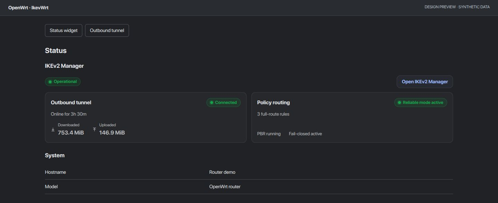

<h1 align="center">IkevWrt</h1>
<p align="center">Outbound IKEv2 VPN and policy routing for OpenWrt.</p>
<p align="center">
  <a href="https://github.com/saeedt20/ikevwrt/releases/latest"></a>
  <a href="https://github.com/saeedt20/ikevwrt/actions/workflows/ci.yml"></a>
  
  <a href="NOTICE"></a>
</p>
<p align="center">
  <a href="https://github.com/saeedt20/ikevwrt/releases/latest">Download APK</a> ·
  <a href="docs/USAGE.md">User guide</a> ·
  <a href="docs/RELEASE-1.13.5.md">Release notes</a> ·
  <a href="https://github.com/saeedt20/ikevwrt/issues">Issues</a>
</p>

Connect your router to an IKEv2 provider such as Windscribe, then control VPN routing by device or destination through an English-only LuCI interface.



*Demo data only. [Outbound Tunnel and Policy Routing previews](docs/UI-REDESIGN.md).*

## Features

- Outbound IKEv2 with provider credentials or certificate authentication.
- Device rules, domain/IP policies, FakeIP routing and fail-closed protection.
- **57,559 bundled Iranian domain suffixes**, direct via WAN by default; no GeoIP ranges bundled.
- Cloudflare-only tunnel DoH, managed router DNS and destination DNS segments.

v1.13.5 removes the inbound server and VPN Users. Services and List sources panels are hidden; existing service rules and background updates are preserved.

## Compatibility and installation

**Only tested on Xiaomi Redmi Router AX6S.** The release APK uses the official **OpenWrt 25.12.6 SDK**, target `mediatek/mt7622`, architecture `aarch64_cortex-a53`. Other devices and IPK builds are unverified. This is an OpenWrt package, not an Android app or firmware image.

Back up your configuration. Download the APK and `SHA256SUMS.apk` from [Releases](https://github.com/saeedt20/ikevwrt/releases/latest), copy them to `/tmp` on the router, then run:

```sh
cd /tmp
sha256sum -c SHA256SUMS.apk
apk add --allow-untrusted /tmp/luci-app-ikev2-manager-1.13.5.apk
```

APKs are **unsigned**: verify the checksum first. Upgrade over the existing package to preserve outbound settings. The client-only migration retains retired inbound data in a private recovery archive on the router. Open **Services → IKEv2 Manager**; see the [setup guide](docs/USAGE.md).

## Validation and privacy

The runtime and UI passed AX6S/OpenWrt 25.12.6 smoke checks in development builds. Local CI covers migration, credentials, DNS rollback, routing and UI behavior. Reboot and sustained-load testing remain outstanding; see the [validation record](docs/RELEASE-1.13.5.md).

Screenshots use synthetic data. Source and APK checks exclude credentials, private keys, router backups and live diagnostics; see the [privacy review](docs/PRIVACY.md).

## Development and credits

Run `./scripts/ci-check.sh` with Node.js, Python 3, jq and OpenSSL. APK builds need the matching official SDK; see [build notes](docs/OPENWRT25.md) and the [repository map](docs/MAP.md).

Application code: [MIT](LICENSE). Bundled Iranian data: [GPL-3.0](luci-ikev2-domains/iran/LICENSE), with [source attribution](luci-ikev2-domains/iran/SOURCE.md). Based on [Nikitid/ikev2-openwrt](https://github.com/Nikitid/ikev2-openwrt), with inherited work from [dreamboxone/ikev2-openwrt](https://github.com/dreamboxone/ikev2-openwrt). Maintained by [@saeedt20](https://github.com/saeedt20).
