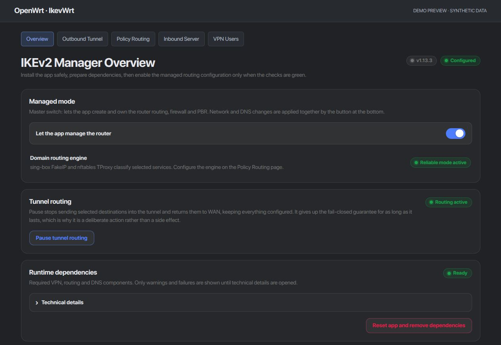

<h1 align="center">IkevWrt</h1>
<p align="center">IKEv2 VPN and policy routing for OpenWrt, managed through LuCI.</p>
<p align="center">
  <a href="https://github.com/saeedt20/ikevwrt/releases/latest"></a>
  <a href="https://github.com/saeedt20/ikevwrt/actions/workflows/ci.yml"></a>
  
  <a href="LICENSE"></a>
</p>
<p align="center">
  <a href="https://github.com/saeedt20/ikevwrt/releases/latest">Download APK</a> ·
  <a href="docs/USAGE.md">User guide</a> ·
  <a href="docs/AUDIT-FIXES.md">Validation</a> ·
  <a href="https://github.com/saeedt20/ikevwrt/issues">Report an issue</a>
</p>

Connect your router to an IKEv2 VPN, choose which traffic uses the tunnel, and manage an optional inbound VPN server through an English-only interface.

**Tested only on Xiaomi Redmi Router AX6S**, running **OpenWrt 25.12.5**, target **`mediatek/mt7622`**, architecture **`aarch64_cortex-a53`**. Other devices, firmware versions and IPK builds are unverified. This APK is an OpenWrt package, not an Android app or a firmware image.



*Application UI rendered locally with synthetic demo data. No live router information.*

## Features

- **IKEv2 connections:** outbound VPN and optional inbound server with user and profile management.
- **Policy routing:** domain and device rules, FakeIP routing, direct-routing lists and pause/resume.
- **DNS controls:** managed resolvers, encrypted DNS and tunnel DNS policies.
- **Safer changes:** validation, rollback, fail-closed rules and runtime health checks.

## Download and install

1. Back up your router settings and confirm the exact model, release, target and architecture above.
2. Download the APK and `SHA256SUMS.apk` from [Releases](https://github.com/saeedt20/ikevwrt/releases/latest), then copy both to `/tmp` on the router.
3. Verify and install:

```sh
cd /tmp
sha256sum -c SHA256SUMS.apk
apk add --allow-untrusted /tmp/luci-app-ikev2-manager-1.13.3.apk
```

The APK is **unsigned**; verify its checksum before using `--allow-untrusted`. Upgrade over the existing package to retain settings. Avoid a system-wide `apk upgrade`.

Open **Services → IKEv2 Manager** in LuCI. For a fresh installation, prepare dependencies on **Overview**, review the readiness checks, then configure the WAN, protected networks and VPN connection. See the [user guide](docs/USAGE.md) for setup and removal.

## Verification and privacy

v1.13.3 passed local CI, an AX6S installation and VPN/DNS smoke checks. Reboot recovery, sustained load and native Windows installation remain untested; see the [audit and validation record](docs/AUDIT-FIXES.md).

Router backups, credentials, private keys and live network captures are excluded from the published source and APK. See the [publication privacy review](docs/PRIVACY.md). Remove these details from any issue or diagnostic report you share.

## Development

With Node.js, Python 3, jq, OpenSSL and Mono installed:

```sh
./scripts/ci-check.sh
```

APK builds require the matching official OpenWrt SDK. See [build and compatibility notes](docs/OPENWRT25.md), [operations](docs/OPERATIONS.md) and the [repository map](docs/MAP.md).

## License and credits

[MIT](LICENSE). Based on [Nikitid/ikev2-openwrt](https://github.com/Nikitid/ikev2-openwrt), with inherited work from [dreamboxone/ikev2-openwrt](https://github.com/dreamboxone/ikev2-openwrt). Maintained by [@saeedt20](https://github.com/saeedt20). External lists retain their own terms; see [NOTICE](NOTICE).
