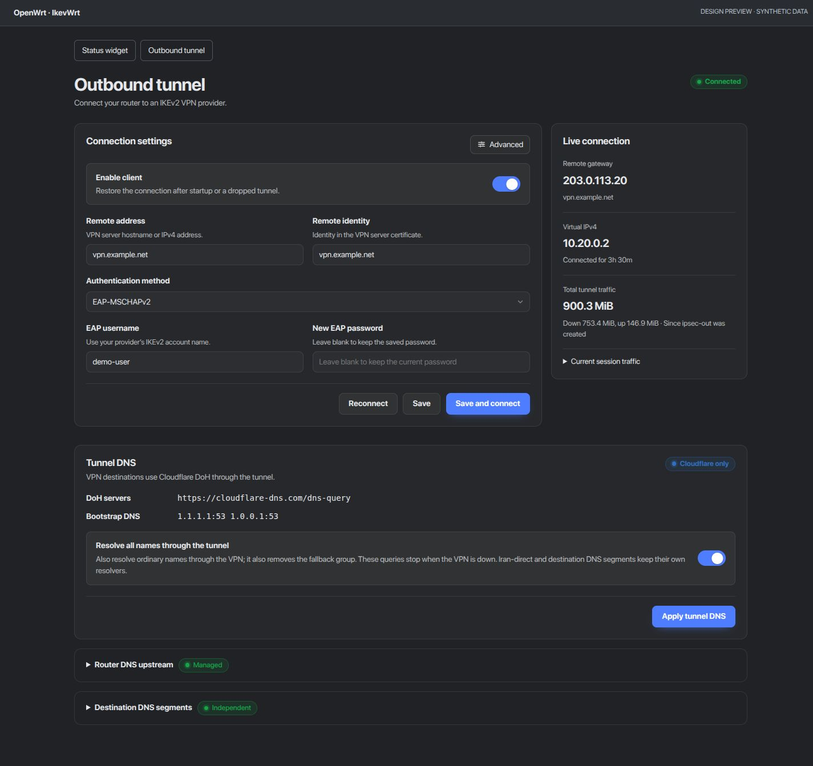
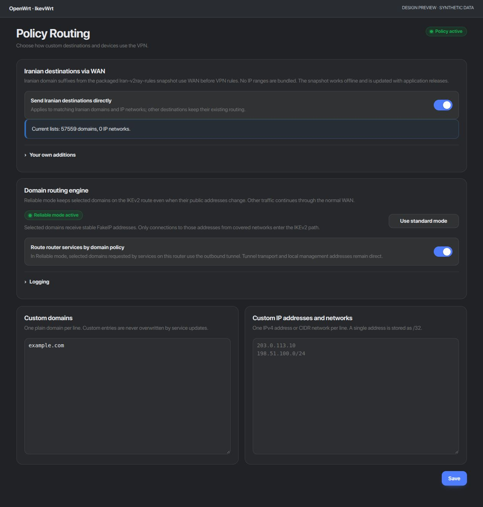

# Status and outbound UI redesign

The Status widget and Outbound Tunnel page were reorganized around connection
health, useful traffic totals and the settings needed to connect a VPN provider.
The runtime/UI was checked on AX6S/OpenWrt 25.12.6 in local development
builds and is packaged for release in v1.13.5.

- Status uses two equal-width panels, readable download/upload totals, a nearby
  manager link and full-route rule counts instead of empty destination counts.
- Connection settings sit beside a compact live summary on desktop and stack
  on phones. Current-session traffic is available in a disclosure.
- Authentication switches hide complete irrelevant fields, including their
  labels. Visible connection fields have associated labels.
- Advanced connection settings remain in place. Router DNS and destination DNS
  segments each have an independent collapsible group and status indicator.
- Tunnel DNS keeps its fixed Cloudflare settings. Connection status reflects an
  installed data SA, including when a custom profile is active.
- Resource filenames were advanced together so cached pages cannot reference
  the previous shared module. The retired Status include is removed to avoid
  displaying duplicate widgets.

No dependencies or polling requests were added. Routing, DNS configuration,
credentials and personal-policy files were unchanged after installation.
The existing Iran-direct priority correction remains installed.

## Validation

Full local CI passed, including new authentication visibility, label association,
custom-profile connection status and full-route count checks. File uploads and
connection transactions retained their existing tests. Browser checks covered
1440px and 390px widths, dark/light themes and expanded advanced/DNS controls.
No horizontal overflow was found in the tested phone layouts.

Installed assets and menu paths were verified. Live health, PBR, fail-closed
and domain-routing checks passed. APK secret scans found no leaks. These
screenshots use synthetic data, contain no live router values and have no EXIF.

No reboot or sustained-load test was performed. The v1.13.5 version/SDK
packaging has not been installed on hardware.

## Previews

## Policy Routing panel visibility

The Services selector and List sources panel are omitted from the view
at the user's request. Service definitions, saved selections, source metadata
and background updates remain intact. A Save regression verifies that editing
custom destinations preserves hidden service selections.

